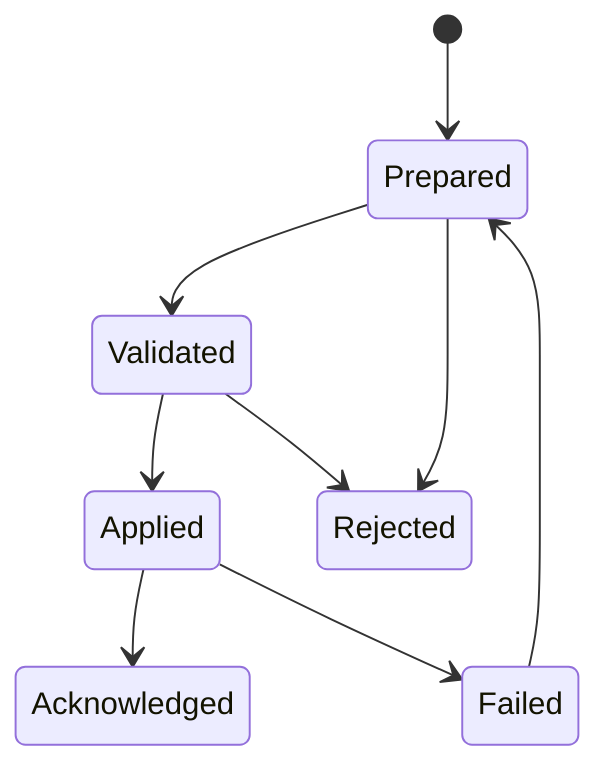

# Edge 控制面同步

> 文档状态：`draft`  
> Owner：Edge Node Control  
> 最后验证：2026-09-04

对外协议阶段固定为 `prepare`、`validate`、`apply`、`ack`。Edge 内部历史代码中的 `switch/report` 必须在实现文档中注明其对应外部阶段，不得作为新的公共协议命名。

节点必须保留最后有效配置，配置摘要、版本、patch sequence 和校验结果必须可观测。控制面不可达时，Edge 可以继续服务最后有效配置，但必须报告 stale 状态。

