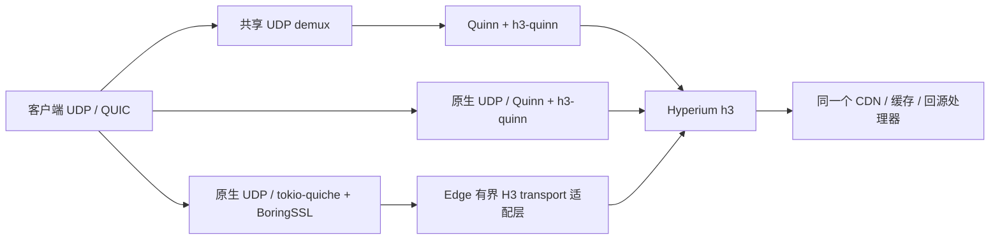

# H3 传输后端

客户端进入 Edge 的 H3 现在可选择三种传输路径，默认仍是共享 UDP 的 Quinn。
它们最终都进入 `Http3ProxyManager::serve_h3_transport`，使用现有站点路由、CDN 缓存、
请求准入、回源和响应处理。性能矩阵运行完整节点，没有用固定正文服务替代这条路径。

## 选择与构建

| 变量 | 值 | 用途 |
|---|---|---|
| `ZELVIK_EDGE_H3_BACKEND` | `quinn-shared`，默认 | 共享 UDP、现有转发及 XDP 路径 |
| 同上 | `quinn-native` | 用同一 Quinn 绕过共享 UDP demux，测量路径开销 |
| 同上 | `tokio-quiche-native` | 实验性 Cloudflare QUIC 传输 |
| `ZELVIK_EDGE_H3_TRANSPORT_PROFILE` | `production`，默认 | 现有生产 Quinn 传输配置 |
| 同上 | `matched` | 用于同条件比较的显式传输参数 |

`tokio-quiche-native` 需要构建特性 `h3-quiche` 和 `matched` profile。
在现有受控 Cargo 构建命令中加入 `--features h3-quiche`，保持仓库工具链及 CPU 基线要求。
变量在进程内固定选择，切换需要重启进程。未知值、未编入功能的选择和不兼容运行模式会返回错误。

依赖为 tokio-quiche **0.20.0**、quiche **0.30.0 + 固定上游 FIN 修复提交**、Hyperium h3 **0.0.8**。
实际 HTTP3 帧处理仍由 Hyperium h3 完成，Edge 适配 `h3::quic` traits。
tokio-quiche 负责 Tokio socket/router/连接任务，quiche 负责 QUIC/TLS 状态机。
0.20.1 的 libc 上界与当前 Edge 依赖冲突，因而使用 0.20.0；0-RTT 关闭。
版本及回归证据见 [FIN 修复报告](performance-h3-quiche-fin-2026-11-03.md)。

Edge 到源站的 **H3 回源**继续使用 Quinn/h3-quinn，拥有独立的空闲池与活跃连接复用。
该方向的改动见[连接池扫描](performance-h3-pool-sweep-2026-11-03.md)及
[活跃回源复用](performance-h3-active-reuse-2026-11-03.md)。

## 同条件比较范围

三条路径使用同一个启用 `h3-quiche` 的生产可执行文件，统一 256 KiB 连接接收/发送预算、
64 KiB 流接收窗口、8 个单向流、1350 字节初始发送 MTU、30 秒空闲超时、Cubic 及
13,500 字节初始拥塞窗口，关闭主动迁移和 PMTU 探测。双向流上限沿用节点 governor。
比较时显式配置地址验证 Off，关闭 0-RTT 和 QUIC DATAGRAM。

Quinn 的 AWS-LC/rustls 与 quiche 的 BoringSSL、拥塞控制具体实现、socket offload 支持仍不同。
quiche 的 UDP 接收上限显式设为 1350，Quinn 端点的接收上限沿用库默认值。
“matched”覆盖上述共同参数，不表示加密实现、内核收发和全部内部默认完全相同。
共享 Quinn 与原生 Quinn 的比较更适合定位 demux 开销；原生两库比较反映整套传输栈。

## 生命周期、内存和功能边界

- 每连接适配层 RX/TX 各 256 KiB；缓冲区的所有 Bytes 克隆继续持有预算，最后一个持有者释放后归还。
  TX 缓冲区预算跟随真实 QUIC ACK/reset 生命周期。任务结束会唤醒等待者并清理队列。
- tokio-quiche 的固定接收队列也计入节点预算：每连接预留 5 MiB；32 个初始连接 backlog
  加一个拒绝处理槽，在监听开始前预留 165 MiB。预算不足显式失败。
  原生 quiche 入口现用内核 socket filter 限定 UDP 正文不超过 1,500 字节，GRO 关闭、GSO 保留。
  上游 recvmsg 接收缓冲区为 64 KiB，单纯广告 1,350 字节 QUIC 参数不能约束入队分配；此前 4 MiB 预留错误，修正前测量须单独标识。
  这是保守逻辑预留，不是“每连接已经占用 5 MiB RSS”；需要在不同连接规模下继续测量。
  `dabf21e` 起，该长期容量计入全局共享账户，独立于短期 request workspace 子预算；
  存续期间保持全额 pending，避免物理观测把暂时未填满的队列容量再次授予。
  最后一个持有者释放时转为 committed-unconfirmed，等待下一次物理观测才解除扣减。
  控制面和已建立流量保留额度继续生效，预算数值和节点内存上限均未放大。
  `b30f0cf` 起，如果额度不足且存在足够的未确认释放额度，先刷新物理观测再按同一硬门槛重试一次；
  存活容量不受该确认影响，没有可确认额度的满池仍直接拒绝。
  `562d49c` 将该检查移到原生容量所有者存在时的公共字节门槛，覆盖更早的连接准入以及请求/工作区准入；
  分类型和监听器配额不进入这条重试路径。未启用原生容量时保持原有账户行为。
- 接受的连接连续驱动 handshake → running → closing；拒绝连接也驱动真实关闭流程，回收 CID 和队列。
  拒绝留下防护日志/计数；原生库可能发出 TLS/QUIC close，不承诺与原路径的静默丢弃行为相同。
- 动态 SNI 精确/通配/默认选择、证书热更新和 OCSP transport/过期检查接入现有原子证书快照。
  PEM 在配置应用阶段解析，每次握手只引用同一快照。OCSP 测试验证发送与过期行为，不替代响应者签名验证。
- 原生实验要求关闭 XDP，并独占对应 UDP 端口；不能与 UDP/QUIC 透传共端口。
  tokio-quiche 还要求显式地址验证 Off，因为当前 API 未实现 Edge 的自适应 Retry 预算合同。
  热更新为不兼容的 Retry 策略会拒绝新连接并记录错误；存量连接继续完成。
- 当前原生端口冲突校验主要在监听创建时执行；共享 UDP/XDP 和全部配置热切换尚未实现原生功能对等。
  因此保持实验开关，生产默认路径不改变。

可复查的真实网络回归覆盖并行正文、重复响应头、双向 trailers、FIN、reset、预算背压、
拒绝清理和受控双向丢包。完整节点特性检查见
[562d49c CI](https://github.com/Zelvik-Labs/edge/actions/runs/41692074674)：
1,350 个库测试、16 个有测试的二进制用例通过；4 个性能探针保持显式 ignored，产物日志无 Rust warning。
短时测试不替代 24/72 小时稳定性验收。
最终接收边界、默认路径及适配层回归见[验收报告](performance-h3-ingress-2026-11-04.md)。
