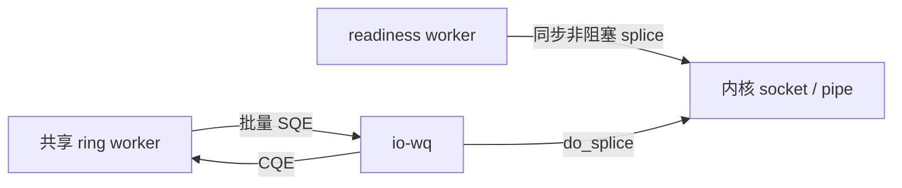

# 共享 io_uring splice 候选（2026-11-02，第 3 轮）

本轮从 `1252e5f1cd0c38c186ad5a09f7e13c17af234428` 开始，在独立分支 `perf/io-uring-20261102` 实现候选。现有代理仍使用 readiness splice；io_uring 在 I/O 库中作为默认关闭的实验 feature，没有接入节点默认 TCP/SNI 选择。性能结论需同时看单连接和多连接批量场景。

## 实际内核能力和实现

使用 crates.io 未撤回的 `io-uring 0.7.15`，发布于 2026-09-07，checksum `ed3bd0ecfbb87805f538bb7b32e5239ca0763890c623e349860ecba69469f2bb`。根锁文件加入该包，既有依赖版本保持。另核对 `tokio-uring 0.5.0`，本轮没有把它作为运行时引入。

云端已实际执行 socket→pipe→socket 的 18 字节完整传输，随后对空闲 POLL 请求执行 ASYNC_CANCEL，核对目标 `-ECANCELED` CQE 与取消成功 CQE。注册探针确认 SPLICE、POLL_ADD、ASYNC_CANCEL、RECV 和 SEND 可用。不是仅凭 `io_uring_setup` 成功判断数据通路可用。

候选每个 worker 创建一个 ring，由多条连接共享提交和完成批次。ring 在 issuer 线程内创建，默认使用 SINGLE_ISSUER / DEFER_TASKRUN。控制通道有界，eventfd 只通知新连接、取消和停止，正文不经过用户态 channel。每条连接仍使用两根 pipe，处理部分写、双向 EOF 和目的端 `SHUT_WR`。计数只累计完成队列确认的目的写；取消时仍处理已成功写入的 CQE，再释放资源并提交 observer 的最后余量。

socket 和 pipe 使用注册文件槽位，既减少重复文件查找，也保证 io-wq 延迟查找输入文件时不会因原 FD 被复用而指向另一连接。槽位在目标 CQE 和取消 CQE 都完成后复用。读取期限用有界的 deadline 集合管理，成功读取或取消时移除，避免长期连接积累过期 timer 项。小 SQ 满时先提交而不等待，防止尚未提交的活跃 I/O 排在空闲 POLL 后面而停滞。提交、取消或能力错误均显式返回，没有失败后静默换引擎。

## 为什么 io_uring 未必胜过直接 splice

核对 Linux [v6.18.57](https://github.com/gregkh/linux/blob/v6.18.57/io_uring/splice.c) 和 [v6.8](https://github.com/torvalds/linux/blob/v6.8/io_uring/splice.c) 上游：`__io_splice_prep` 设置 `REQ_F_FORCE_ASYNC`。两者分别对应云环境和已观察到的 GitHub runner 内核系列。SPLICE 会经过 io-wq；不能把节省 `io_uring_enter` 的批量收益等同于减少所有调度成本。

这解释了为何本轮同时记录线程、FD、批量提交和正文计数，而不是预设换库会更快。完整节点的路由、TLS、TOA、资源准入和统计守卫尚未迁入该候选，不能拿组件成绩声明整个 Edge 已换后端或超过 Nginx/OpenResty。

## 已完成的验证

原 I/O 5 项测试与新增 10 项测试全部通过：最终响应与半关闭、取消期间写计数、丢弃 ticket 释放 socket、小 ring 下活跃连接推进、压力读取期限、停止并清空连接、512 KiB 正文经过 4 KiB pipe、同一 worker 的 16 条并发连接、容量拒绝后既有连接继续服务，以及对端 RST 保持可观察错误。默认 feature 与启用 io_uring 的全目标 Clippy 均通过，没有新增 warning 或忽略测试。

基准扩展为 1 / 16 条连接，各自采用同一 release 二进制对比 readiness 与 io_uring，统一两个 CPU 和 1 KiB / 64 KiB / 1 MiB 正文，三轮交错独立进程。16 连接共享一个 ring，测量迭代中不新增 task、Arc clone 或 Vec 分配。每个连接校验完整正文、最终双向字节和交换数；16 连接的单次迭代是一个并发批次，数据另外给出归一化往返耗时。

## 本地结果

36 个场景全部成功，测试期间源码与二进制校验和未变化。下表是每轮 `io_uring 平均批次耗时 / readiness 平均批次耗时 - 1`，正数表示变慢；中位数按三个配对变化计算：

| 连接 | 正文 | 第 1 轮 | 第 2 轮 | 第 3 轮 | 配对中位数 |
| --- | --- | ---: | ---: | ---: | ---: |
| 1 | 1 KiB | +97.96% | +28.52% | +240.47% | +97.96% |
| 1 | 64 KiB | +42.26% | +16.69% | +39.26% | +39.26% |
| 1 | 1 MiB | +32.48% | +48.36% | -57.78% | +32.48% |
| 16 | 1 KiB | +32.07% | +11.88% | +274.20% | +32.07% |
| 16 | 64 KiB | +53.91% | +55.89% | +34.18% | +53.91% |
| 16 | 1 MiB | +3.91% | +68.52% | +47.22% | +47.22% |

16 连接的 `mean_per_roundtrip_ns` 是批次耗时除以 16，表示均摊耗时，不是单请求时延分布或 P99。所有快慢轮次都保留，未用单次较快结果覆盖整体判断。

进程观测也确认了源码中的工作队列结构。第 1 轮单连接 readiness 为 18 FD、5 个线程；io_uring 为 20 FD、8 个线程，其中一个 `edge-uring` 和两个 `iou-wrk`。16 连接对应 138/140 FD；io_uring 实际有 7 个 io-wq 线程，加上专用 ring worker，比 readiness 多 8 个线程。线程数包含同一客户端/回源/统计进程的公共开销，不能当成整个 Edge 的生产线程总数。

批处理确实发生：第 1 轮 16 连接、1 KiB 时，123,472 次已校验往返对应 258,963 次提交和 987,727 条 CQE，约 3.81 CQE/提交；单连接则接近一条 CQE/提交。本地结果说明，这些批量收益还没有抵消该 SPLICE 路线的整体成本。io-wq、专用用户态 worker 与状态机的具体耗时比例尚未拆分，不能把所有回退都归因于单一因素。

[单连接汇总](evidence/io-uring-2026-11-02/c1-summary.json)、[16 连接汇总](evidence/io-uring-2026-11-02/c16-summary.json)、[线程/FD/批量归一化结果](evidence/io-uring-2026-11-02/resource-summary.json)、[CPU 快照](evidence/io-uring-2026-11-02/cpu-summary.json)、[全部原始样本/日志/探针与内核源码](evidence/io-uring-2026-11-02/local-raw.zip)、[逐文件校验清单](evidence/io-uring-2026-11-02/local-archive-manifest.json)。

基于当前结果，候选只保留在实验分支，不接入默认转发路径。GitHub Actions 的实际提交、run、原始产物将在执行后记录。新增可选 `io_uring_benchmark=true` 输入：启用候选测试与 Clippy，编译完成后依次执行单连接和 16 连接的独立比较，上传样本与失败日志。不能将之前 readiness 提交的 CI 结果移用到本候选。

本轮没有批准或实施生产功能降级。云环境已确认可建立独立 user/network namespace，Docker CLI 也存在；尚未验证 BPF/XSK 权限或硬件零复制。RKE 继续暂缓；真实 NIC、完整 HTTP/缓存矩阵与长期稳定性仍需后续验证。
