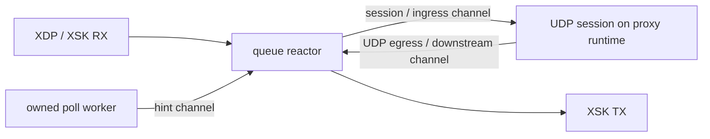

# 第 12 轮：UDP 系统调用归因

128 次完整代理追踪、136/136 场景、122.4 万计时 RTT 独立复核通过。单流下 Edge 每请求约 **18–22 次 syscall**，Nginx/OpenResty 约 **7 次**，差异集中在 poll、epoll、futex、write；16 流下 Edge 已批处理到约 **1.3–1.75 次**，基线约 **6 次**。这些结果支持继续调查单流唤醒与调度，但**不支持把所有并发档位的差距都归因于 syscall 数量**。本轮为 ptrace 诊断，没有新的原生吞吐提升结论。

源码 `d30b4ab9a253fefd91038f273a4b8d35ac7f6f6f`，独立分支 `perf/udp-syscalls-20261103`，[Actions 41581678506](https://github.com/Zelvik-Labs/edge/actions/runs/41581678506) 两个执行 job 均成功，包括原有 Rust/Clippy/Pingora/eBPF 门禁及完整诊断矩阵。独立内核探针未选择，按条件跳过。运行时 Rust 与 C 负载工具逐字节等同第 11 轮 `1fbca822`，只新增观察工具、工作流与文档。

## 实现与验证

新 `xdp_udp_profile=true` 入口保留四轮轮换、1/2 代理 CPU、64/1200 字节、1/16 流和全部正文/序号/复用/亲和性/队列检查。诊断每流预热 1,000 次，单流计时 2,000 次、16 流每流计时 1,000 次；原有不追踪性能矩阵的迭代数不变。共 136 记录，含 8 个不追踪的 direct 校准；128 个代理追踪覆盖 115.2 万计时请求，含预热与 direct 共 238 万次请求/响应。

在显式 warmup gate 后启动 `strace -f -c -w -qq`，向观察到的代理进程树附加。`/proc` 必须在 GO 前及 DONE 后确认每个观察线程由该 tracer 跟踪。trace 覆盖整个计时与快照窗口，正常分离后核对所有观察线程 `TracerPid=0`，才开始 2.2 秒空闲采样。实际窗口约 0.67–5.03 秒；不包含预热和空闲观察。

全部 128 次为主动 SIGINT 后退出 `-2`，原始状态保留。只有明确发送该信号、完整覆盖、正常分离并生成可校验统计才接受；任何提前退出，包括零或 SIGINT，都失败。未完成测量的 abort 会单独记录 `completed=false`，不会作为有效追踪。原始调用数、错误返回数与总数逐项重算，所有 RTT、时间范围、CPU、模式、配置、摘要和双向 redirect 再次核对。

本地四项真实私有进程测试与五项已有分析检查通过：覆盖多线程附加、200 次已知 getpid 调用、正常分离、提前终止和取消。初次 Yama 准备调用在接口缺失的本地返回 EINVAL，随后按实际接口修正；首次对主动 SIGINT 的退出状态假定为零也失败，按真实信号语义修正。失败日志全部保留，未降低代理报文或队列校验。本地没有原生 AF_XDP 成功声明。

## 观测结果

Ubuntu 官方 runner，Linux `6.8.0-1070-azure`，strace 5.16，x86-64-v2、release、单 XSK 队列、SKB/copy，两个 CPU 预算顺序运行，四种实现使用相同 offload 设置。全部观测 CPU steal 为 0。两预算使用相同 Edge、Nginx、OpenResty、C 客户端二进制与源文件摘要。

下表为每次**计时请求**的 syscall 次数，分别取同格四轮中位数。Full/Bridge 几乎相同，表中使用 Bridge。不同 syscall 的中位数之和不一定等于总数中位数。错误返回也计入，不能把 syscall 错误数直接等同应用失败。

| 代理 CPU | 流/字节 | Edge 总数 | poll | epoll_wait | futex | write | sendto | Nginx 总数 | OpenResty 总数 |
| --- | --- | ---: | ---: | ---: | ---: | ---: | ---: | ---: | ---: |
| 1 | 1 / 64 | 18.30 | 5.004 | 6.072 | 2.002 | 2.870 | 2.000 | 7.00 | 7.00 |
| 1 | 1 / 1200 | 18.29 | 5.006 | 6.074 | 2.001 | 2.888 | 2.000 | 7.00 | 7.00 |
| 2 | 1 / 64 | 22.42 | 5.054 | 6.097 | 6.024 | 2.928 | 2.000 | 7.00 | 7.00 |
| 2 | 1 / 1200 | 22.35 | 5.048 | 6.078 | 6.016 | 2.891 | 2.000 | 7.00 | 7.00 |
| 1 | 16 / 64 | 1.32 | 0.251 | 0.538 | 0.001 | 0.251 | 0.249 | 6.00 | 6.00 |
| 1 | 16 / 1200 | 1.32 | 0.251 | 0.536 | 0.001 | 0.249 | 0.247 | 6.00 | 6.00 |
| 2 | 16 / 64 | 1.71 | 0.252 | 0.506 | 0.459 | 0.229 | 0.227 | 6.00 | 6.00 |
| 2 | 16 / 1200 | 1.75 | 0.252 | 0.514 | 0.475 | 0.238 | 0.235 | 6.00 | 6.00 |

Nginx/OpenResty 单流约 epoll_wait 2、recvfrom 2、recvmsg 1、sendmsg 2；16 流约 epoll_wait 1，其余约 2/1/2。Edge 未观察到 recvfrom/recvmsg/sendmsg，上表 sendto 与 driver TX kick 路径一致。完整 Full/Bridge、四轮和所有稀有调用均保留在[规范化数据](evidence/udp-syscalls-2026-11-03/syscall-normalized.json)；未出现的 syscall 只在完整且未过滤的 trace 中按观测零处理。

所有代理应用/回源计数匹配，Node 双向 redirect 为请求总数两倍，流水线六个收发计数、会话创建数和实际源端口复用匹配，所报队列、路由、限流、发送错误及丢弃为 0。完整性在固定 C 客户端运行时验证，RTT 文件本身不能重建正文。退出和网络清理通过，没有用重试替换失败场景。

## 代码架构解释与尚未证明的部分

`udp_proxy.rs` 的 `UpstreamUdpSocket` 在 AF_XDP 注册存在时选择 `AfXdpUdpSocket`。`dial.rs` 将发送变成 `AfXdpReactorRequest::UdpEgress`，由拥有队列的 reactor 组帧并经 XSK TX ring 发出；回源回复通过 `AfXdpUdpIngress` 交给会话任务。会话任务在共享 proxy runtime，queue reactor 另有当前线程 runtime。下游发送还需回到队列通道。

因此，Node 并非前端绕过内核后仍按普通内核 UDP socket 读写上游。Nginx/OpenResty 的内核 socket 调用与 Node 的 ring、虚拟 socket、通道和 runtime 路径不是同一结构。单流下额外 poll、epoll、futex 与这类唤醒/跨任务交接相符；双核单流 futex 由约 2 次变成约 6 次，更值得检查跨 runtime 调度。但 ptrace 会改变竞争与批处理，不能据此定量声称哪一层占了原生延迟的多少比例。

16 流下 Node 将 ring 操作批处理，syscall 密度显著下降；当前结果没有显示它在该档位调用更多。还需观察原生 CPU 热点、内存/校验和/所有权成本以及调度等待。第 10 轮裸吞吐测量属于另一提交与条件，不能把本轮调用数代入其耗时或计算容量占比。

聚合 trace 不能区分 poll 的零超时驱动检查与 owned worker 的阻塞等待，也没有 write 的 FD 类型。Tokio 唤醒可能涉及 eventfd，但**尚不能把全部 write 归给 eventfd、日志或统计**。Node 每场景 stdout/stderr 日志仅约 3.1KB，退出报告还在 trace 之后；这不证明其他 FD 的行为。未发现数据就作日志写盘归因是不成立的。

本负载为普通 UDP，H3 全局端口与它不同，未进入 QUIC 状态机。这个结果不能用来判定 Quinn/tokio-quiche 的优劣，也不能替代 H3 缓存、HTTP 或真实 NIC 的容量对照。

下一阶段优先实验减少空闲事件等待后的重复 runtime 让出，同时保留忙路径公平性、取消、定时器与错误处理；以同二进制 Eager/协作预算对照验证，先保持默认行为。站点回退 1,000 站点约 37μs 的线性扫描另有第 11 轮证据，后续预建端口索引需单独覆盖全部更新路径与匹配网络负载。两者都尚未在本报告中实现或证明收益。

## 证据与限制

产物 `13207203051`：**5,442,787 字节、2,789 文件**，SHA256 **`fecd02715f7f9a22cc378407840fe61a478ffb53c6e2171c985593226a94c440`**，与 GitHub digest 一致。Edge release 摘要 `453703601ab30d2134a1587ae37500a5dbeff5ce72a47b732f3352b38a827109`，两预算不变。

- [原始 ZIP](evidence/udp-syscalls-2026-11-03/ci-raw.zip)、[清单](evidence/udp-syscalls-2026-11-03/ci-manifest.json)、[GitHub 元数据](evidence/udp-syscalls-2026-11-03/ci-artifact.json)、[最终 job/step](evidence/udp-syscalls-2026-11-03/ci-jobs.json)。
- [独立重算](evidence/udp-syscalls-2026-11-03/validation.json)、[校验器](evidence/udp-syscalls-2026-11-03/validate-profile.py)、[全部规范化调用](evidence/udp-syscalls-2026-11-03/syscall-normalized.json)、[条件/清理](evidence/udp-syscalls-2026-11-03/conditions.json)、[包含所有受扰动时间与质量标志的原始汇总](evidence/udp-syscalls-2026-11-03/summaries.json)。
- [本地通过及初始失败](evidence/udp-syscalls-2026-11-03/local-validation.zip)、[清单](evidence/udp-syscalls-2026-11-03/local-manifest.json)。10 文件、2,917 字节，SHA256 `0e0085da3b1963e17963a04891add117081454d8fa763b364943451c9a2f2790`。

ptrace 严重扰动时间、调度与批处理；累计 syscall wall time包括线程等待，不能当作 CPU 消耗。窗口含快照边界开销。没有物理 NIC、零复制或长期稳定性结果，没有新的未追踪 Nginx/OpenResty 吞吐比较。

没有功能降级、H3 库切换、发行、部署或 main 合并。RKE 暂缓，缓存保留，空间底线不变。
